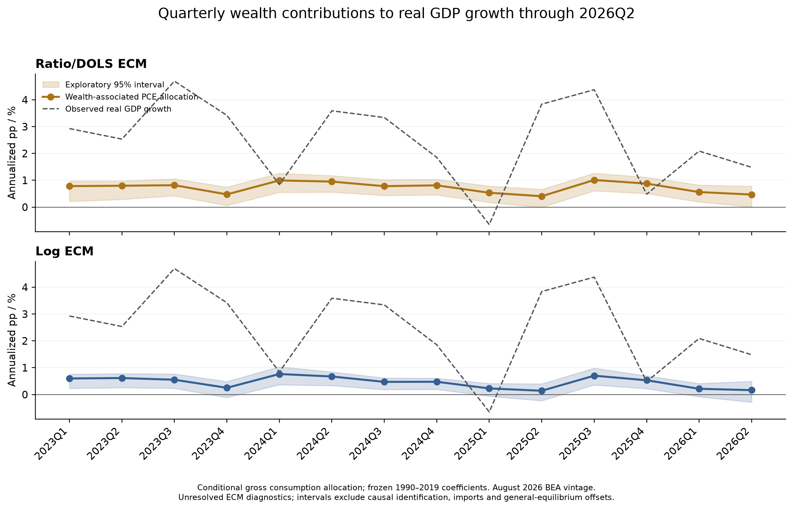

# Wealth effects: quarterly ECM estimates

Estimate the relationship between U.S. household wealth and consumption with
quarterly error-correction models, then allocate the estimated consumption
channel to real GDP growth. Observed inputs and results run through **2026Q2**.
The estimation window is **1990Q1–2019Q4**; coefficients stay fixed afterward.

This is a reproducible methodological adaptation of Banque de France
[Eco Notepad 454](https://www.banque-france.fr/system/files/2026-06/Billet_454_VE.pdf),
with a second long-run specification motivated by
[Beach, Gamber and Moran (2025)](https://www.federalreserve.gov/econres/notes/feds-notes/wealth-heterogeneity-and-consumer-spending-20250805.html).
The note does not publish its full equation, coefficients or replication code,
so agreement with a headline result does not establish exact replication.



Wealth-associated contributions to **quarter-over-quarter annualized real GDP
growth**, in percentage points:

| Quarter or period | Ratio/DOLS ECM | Log ECM |
| --- | ---: | ---: |
| 2026Q1 | 0.561 | 0.214 |
| 2026Q2 | 0.469 | 0.163 |
| 2026 H1 mean of quarterly contributions | 0.515 | 0.188 |
| H1 exploratory 95% interval | [0.183, 0.723] | [-0.087, 0.340] |

The ratio specification is shown first for comparison with the note; the log
specification provides a functional-form sensitivity. Neither is established
as the authors' exact model. The H1 mean averages Q1 and Q2 annualized
contributions; it is not a full-year 2026 estimate.

The figures are **conditional consumption-channel allocations**, not causal
GDP effects. The GDP bridge uses BEA's published PCE contribution and preserves
its accounting total. Induced imports and general-equilibrium feedbacks are
not identified. GDP/PCE data retain the **August 26, 2026 BEA vintage**.

Econometric checks also qualify the interpretation: the log model's
Engle–Granger test does not reject no cointegration (p ≈ 0.883); both models
retain residual serial correlation (four-lag Breusch–Godfrey p ≈ 0.008 and
0.006). The nonlinear ratio target has no formal cointegration validation.
Bootstrap intervals are exploratory and conditional on observed inputs and
the maintained model.

## Reproduce

Requires Python 3.12 or newer. The supplied derived quarterly inputs and saved
joint bootstrap parameters allow an offline run without API credentials or a
private source repository.

```bash
git clone https://github.com/rmmomin/wealth-effects-ecm.git
cd wealth-effects-ecm
python3 -m venv .venv
.venv/bin/python -m pip install -r requirements-ecm.txt
.venv/bin/python scripts/run_ecm.py
.venv/bin/python -m unittest discover -s tests -v
```

To regenerate the conditional two-stage bootstrap rather than reuse its saved
parameter vectors:

```bash
.venv/bin/python scripts/run_ecm.py --rebuild-bootstrap
```

See [reproduction details](docs/REPRODUCIBILITY.md) for units, horizon,
configuration and verification.

## Methodology

### Variables and units

Let $C_t$, $Y_t$ and $T_t$ denote real consumption, disposable income and
transfer receipts as **actual quarterly flows**. Let $W_{80,t}$ and
$W_{20,t}$ denote real quarter-end net worth for the bottom 80% and top 20%
of households ranked by **income**. Flows and stocks use billions of
2017-dollar PCE purchasing power; stocks are never annualized. Lowercase
$c_t$, $y_t$ and $w_{j,t}$ denote natural logs, and $\Delta$ denotes a
quarterly first difference.

Net worth includes financial and nonfinancial assets less liabilities.
These specifications estimate aggregate wealth relationships; they do not
separately identify housing, equity and bond MPCs.

### 1. Log ECM: long-run consumption elasticities

The first stage estimates the following relation by ordinary least squares:

$$
c_t=a+b_Y y_t+b_{80}w_{80,t}+b_{20}w_{20,t}+e_t.
$$

Its fitted equilibrium error becomes the second-stage regressor:

$$
ECT_t^{\log}
=c_t-\widehat a-\widehat b_Y y_t
 -\widehat b_{80}w_{80,t}-\widehat b_{20}w_{20,t}.
$$

The coefficients $b_{80}$ and $b_{20}$ are long-run consumption
**elasticities**, rather than constant consumption dollars per wealth dollar.
No coefficient signs or target contribution values are imposed.

### 2. Ratio/DOLS ECM: annual-flow wealth slopes

Define annualized flows $C_t^A=4C_t$, $Y_t^A=4Y_t$ and $T_t^A=4T_t$.
The normalized consumption and wealth variables are:

$$
R_t=\frac{C_t^A-T_t^A}{Y_t^A-T_t^A},
\qquad
Q_{j,t}=\frac{W_{j,t}}{Y_t^A-T_t^A},
\quad j\in\{80,20\}.
$$

Dynamic ordinary least squares (DOLS) includes one lead, the current
difference and one lag of each wealth ratio:

$$
R_t=\alpha+\beta_{80}Q_{80,t}+\beta_{20}Q_{20,t}
 +\sum_{j\in\{80,20\}}\sum_{\ell=-1}^{1}
   \delta_{j,\ell}\Delta Q_{j,t-\ell}+u_t.
$$

Those difference terms are estimation controls. The equilibrium consumption
target uses only the fitted level coefficients:

$$
C_t^*=T_t+\widehat\alpha(Y_t-T_t)
 +\frac{\widehat\beta_{80}W_{80,t}
        +\widehat\beta_{20}W_{20,t}}{4},
\qquad
ECT_t^{\mathrm{ratio}}=\log C_t-\log C_t^*.
$$

Thus $\beta_j$ measures **annual consumption dollars per wealth-stock
dollar**, and the corresponding quarterly slope is $\beta_j/4$.
The normalization assumes a long-run transfer MPC of one when income
excluding transfers and wealth are held fixed. Every target must be positive.
DOLS leads are constructed within 1990–2019, so post-2019 observations never
enter estimation; boundary trimming leaves 117 first-stage observations.

### 3. Shared short-run adjustment equation

Each specification separately estimates:

$$
\Delta c_t=\kappa+\lambda ECT_{t-1}
 +\phi\Delta c_{t-1}
 +\theta_0^{\mathsf T}x_t+\theta_1^{\mathsf T}x_{t-1}
 +\varepsilon_t,
$$

where

$$
x_t=
\begin{bmatrix}
\Delta\log(Y_t-T_t)\\
\Delta\log T_t\\
\Delta\log B_t\\
\Delta\log S_t\\
\Delta U_t
\end{bmatrix}.
$$

Here $B_t$ is real household and nonprofit loans, $S_t$ is the nominal
quarter-end S&P 500 price index, and $U_t$ is the unemployment rate in
percentage points. A negative $\lambda$ represents correction of consumption
above its fitted target; the joint dynamics also depend on $\phi$.
The second stage uses OLS with four-lag Bartlett HAC standard errors.
Both models are estimated on 1990Q1–2019Q4 and then held fixed through 2026Q2.

### 4. Historical wealth and other consumption channels

The accounting starts at baseline $0=1989\mathrm{Q}4$. For each channel $k$,
let $z_{k,t}$ be its cumulative contribution to the change in log consumption,
with $z_{k,0}=0$. Estimated dynamics propagate its forcing term $\nu_{k,t}$:

$$
\begin{aligned}
\Delta z_{k,t}
 &=\widehat\lambda z_{k,t-1}
   +\widehat\phi\Delta z_{k,t-1}+\nu_{k,t},\\
z_{k,t}&=z_{k,t-1}+\Delta z_{k,t},\\
\sum_k\Delta z_{k,t}&=\Delta c_t.
\end{aligned}
$$

For the first update, the observed baseline consumption-growth lag belongs
to the initial-state channel:

$$
\Delta z_{k,0}=
\begin{cases}
\Delta c_0,&k=\mathrm{initial\ state},\\
0,&\text{otherwise}.
\end{cases}
$$

Channels include wealth, income and transfers, credit, unemployment,
deterministic terms, initial conditions and unexplained innovations.
In the log model the wealth target change from baseline is
$s_{W,t}=\widehat b_{80}(w_{80,t}-w_{80,0})
       +\widehat b_{20}(w_{20,t}-w_{20,0})$.
Its forcing includes $-\widehat\lambda s_{W,t-1}$ and the estimated
current/lagged S&P price-change terms. Presample driver terms enter initial
conditions, which also retain $\widehat\lambda ECT_0$ each quarter.

For the nonlinear ratio target, define income bundle $I_t=(Y_t,T_t)$,
wealth bundle $W_t=(W_{80,t},W_{20,t})$, and
$f(I,W)=\log C^*(I,W)$. The wealth target change averages the two possible
orders of updating income and wealth:

$$
s_{W,t}=\frac12\left[
 f(I_0,W_t)-f(I_0,W_0)
 +f(I_t,W_t)-f(I_t,W_0)
\right].
$$

The analogous income allocation sums with $s_{W,t}$ to the full log-target
change. This Shapley split is an explicit accounting convention for
interactions. It does not identify a causal intervention.

### 5. Annualization and contribution to real GDP growth

Write observed quarterly log consumption growth as $g_t=\Delta c_t$.
The annualized consumption contribution of channel $k$, in percentage
points, uses a **common conversion based on observed total growth**:

$$
a_{k,t}
=100\frac{\exp(4g_t)-1}{g_t}\Delta z_{k,t},
\qquad
\sum_k a_{k,t}=100\left[\exp(4g_t)-1\right].
$$

The common conversion factor approaches 400 as $g_t$ approaches zero.
Let $h_t^{\mathrm{PCE}}$ be BEA's published PCE contribution to annualized
quarterly real GDP growth. The primary GDP allocation is:

$$
h_{k,t}^{\mathrm{GDP}}
=h_t^{\mathrm{PCE}}\frac{\Delta z_{k,t}}{g_t},
\qquad
\sum_k h_{k,t}^{\mathrm{GDP}}=h_t^{\mathrm{PCE}}.
$$

The headline wealth estimate is $h_{W,t}^{\mathrm{GDP}}$. Including residuals
and initial conditions preserves the published PCE accounting total.
The GDP bridge is undefined at zero consumption growth; the runner rejects
$|g_t|\leq10^{-10}$. Small denominators can still make allocations sensitive.
These are conditional gross consumption allocations; induced imports and
general-equilibrium feedbacks are not estimated.

The 2026 H1 headline is
$(h_{W,2026\mathrm{Q}1}^{\mathrm{GDP}}
 +h_{W,2026\mathrm{Q}2}^{\mathrm{GDP}})/2$,
the mean of two annualized quarterly contributions. It differs from
H1-over-H1 growth and from a full-year contribution.

Exploratory 95% intervals use 399 joint two-stage bootstrap draws per model:
centered short-run residuals are resampled in circular four-quarter blocks,
consumption is simulated, and both stages are refitted while other observed
paths remain fixed. Each draw is decomposed and converted before quantiles
are taken. Numerical reconciliation does not resolve the cointegration and
serial-correlation limitations described above.

See [the full methodology](docs/ECM_METHODOLOGY.md) for initialization,
period-level GDP accounting and inference details.

## Results and documentation

| Resource | Contents |
| --- | --- |
| [Quarterly GDP chart](results/quarterly_gdp_wealth.pdf) | Estimates and exploratory intervals |
| [Quarterly estimates](results/quarterly_gdp_growth.csv) | Both specifications through 2026Q2 |
| [Period summaries](results/period_summary.csv) | Annual and H1 growth conventions |
| [Model coefficients](results/coefficients.csv) | Estimated long-run and short-run parameters |
| [Diagnostics](results/diagnostics.json) | Tests, stability and model status |
| [Data sources](docs/DATA_SOURCES.md) | Series, transformations, vintages and gaps |
| [Local archive policy](docs/LOCAL_ARCHIVE.md) | Preservation of the earlier research working tree |

## Repository layout

```text
config/ecm.json                 estimation and publication settings
data/                           derived inputs and saved bootstrap parameters
wealth_effects/                  reusable ECM and GDP-accounting modules
scripts/run_ecm.py               portable research runner
tests/                          numerical and accounting validation
results/                        tables, diagnostics and publication charts
docs/                           methodology, sources and reproduction guide
```

Provider source documents and raw archives are excluded from this public
release. Source links and factual derived inputs support the calculations;
their inclusion does not grant rights to upstream material. See
[data provenance](data/sources.json).
