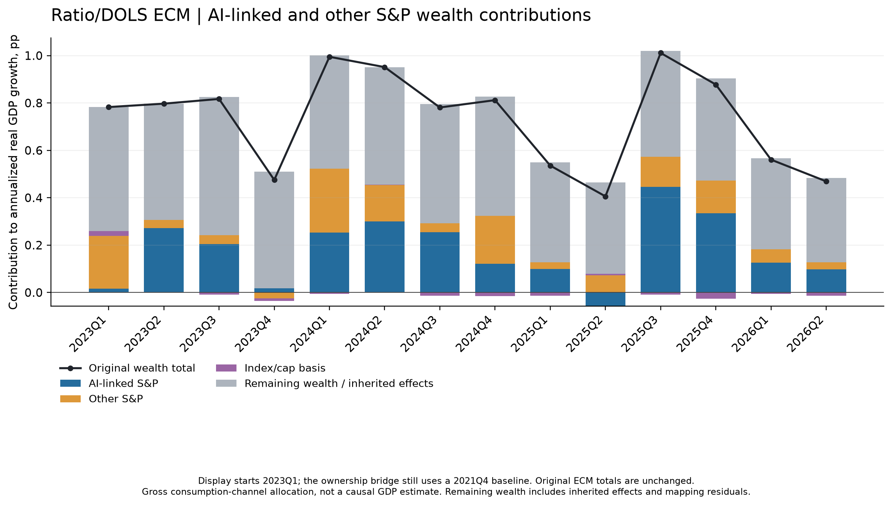

# AI-linked S&P subdivision of the quarterly ECM

New split: **2022Q1–2026Q2**, with a **2021Q4** opening portfolio. The full ECM recursion still starts from 1989Q4. Existing 1990–2019 coefficients and all 399 saved joint draws per model are reused; no equation is refitted.

2026 H1 **mean quarterly annualized** real GDP contributions, percentage points, using the ownership bridge:

| Model | AI-linked S&P | Other S&P | Index/cap basis | Remaining wealth / inherited | Original total wealth |
| --- | ---: | ---: | ---: | ---: | ---: |
| Ratio/DOLS ECM | 0.112 | 0.043 | -0.010 | 0.370 | 0.515 |
| Log ECM | 0.010 | -0.004 | -0.011 | 0.194 | 0.188 |

Charts focus on the **Ratio/DOLS ECM from 2023Q1 onward**. This display cutoff
does not change the primary 2021Q4 split baseline or any estimated contribution.



The four parts sum to the original wealth total in every quarter and every joint draw. Income, credit, unemployment, residual and initial-condition channels are preserved. The remaining-wealth category includes housing, other assets/liabilities, inherited effects and the discrepancy between mapped capitalization changes and observed net worth; it is not an estimate of housing alone.

The ownership bridge allocates capitalization changes using lagged aggregate household beneficial-equity ownership and lagged DFA income-group equity shares, with a common AI/other composition within each income group. These are explicit incidence assumptions. A second `price_control_only` version subdivides only the existing S&P price control. A 2023Q1 start/2022Q4 baseline is included as sensitivity, because the 2022 equity decline affects the attribution.

[Quarterly estimates and pointwise intervals](quarterly_wealth_split.csv), [period means and intervals](period_summary.csv), [all consumption-to-GDP channels](quarterly_all_channels.csv), [mapping sensitivity chart](mapping_sensitivity.png), [diagnostics](diagnostics.json), [hash manifest](run_manifest.json), [methodology](../../docs/AI_ECM_SPLIT.md).

These are conditional gross consumption allocations of BEA's published PCE contribution, not an identified causal contribution of AI to GDP. The original ECM diagnostics remain unresolved. Intervals condition on fixed incidence assumptions, data, basket and model form; component interval endpoints need not sum. S&P-specific AI capitalization is narrower than the broader AI basket in the original AI wealth calculation, and this ECM bridge does not apply that study's import/overlap offsets.

The new market-cap input is user-supplied; its public vendor/constituent provenance is not verified. AI/non-AI market-cap observations and the detailed capitalization/ownership ledger are excluded from public Git; [provenance and units](../../data/spx_ai_split_sources.json) are retained. Reproduction requires supplying the input locally using the [documented schema](../../docs/AI_ECM_SPLIT.md). The S&P total is divided by 1,000, as confirmed by the user, to match AI caps in USD billions. Capitalization changes may include issuance, buybacks and membership effects. Original GDP/PCE retain the August 26, 2026 vintage; AI data come from the existing later September snapshot.

```bash
python scripts/run_ai_ecm_split.py
python -m unittest discover -s tests -p 'test_ecm_ai_split.py' -v
```
